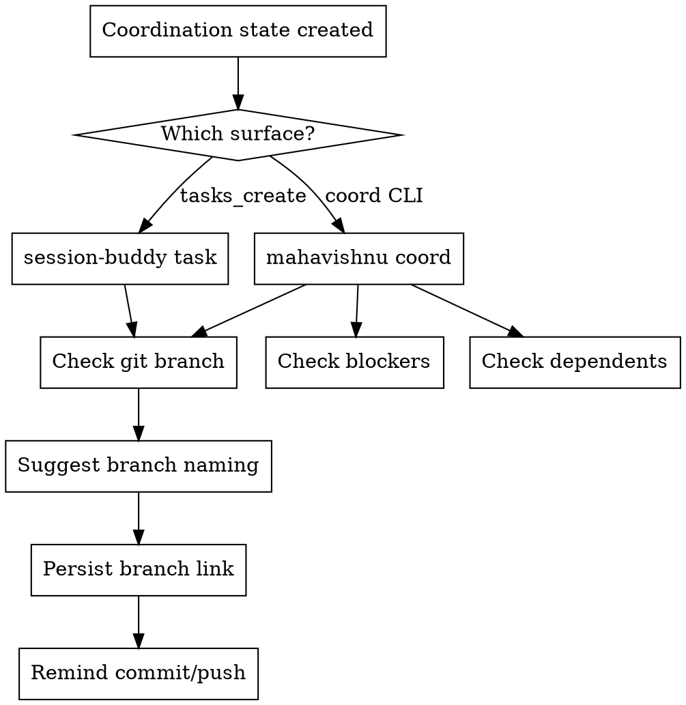

# Auto-Coordinate

## Overview

Coordination state without git linkage is ephemeral. When work is tracked
in an issue, a todo, or a session-buddy task, this skill ties that record
to a git branch so the linkage survives the session that created it.

Two coordination surfaces are live, and this skill covers both:

| Surface | Tools | Where the state lives |
|---|---|---|
| Session-Buddy task | `tasks_create`, `tasks_update`, `tasks_complete` (MCP) | Session-Buddy's task store |
| Mahavishnu coordination | `mahavishnu coord create-issue` / `create-todo` / `close-issue` / `complete-todo` (CLI) | `coordination:` block in `settings/ecosystem.yaml` |

**Core principle:** always link coordination state to a branch.

## Activation

**Reactive** — fires after one of these is called:

| Trigger | Action |
|---|---|
| `mcp__session-buddy__session_buddy_tasks_create` | Check the git branch, suggest a branch name, persist the link via `tasks_update` |
| `mcp__session-buddy__session_buddy_tasks_complete` | Check for uncommitted work, remind to commit/push, suggest branch cleanup |
| `mahavishnu coord create-issue` | Check the git branch, suggest a branch name from the issue ID |
| `mahavishnu coord create-todo` | Check for blocking issues, suggest dependencies |
| `mahavishnu coord close-issue` | Check for uncommitted work, remind to commit/push, suggest branch cleanup |
| `mahavishnu coord complete-todo` | Check for dependent todos, suggest next steps |



## When to Use

**Use when:**

- Claude just called `mcp__session-buddy__session_buddy_tasks_create` — link the task to a branch
- Claude just called `mcp__session-buddy__session_buddy_tasks_complete` — wrap up the git state
- Claude just ran `mahavishnu coord create-issue` — link the issue to a branch
- Claude just ran `mahavishnu coord create-todo` — check for blockers
- Claude just ran `mahavishnu coord close-issue` or `complete-todo` — wrap up the git state
- The user asks to "create an issue", "track a todo", "close an issue", "create a task", or "complete a task"

**Don't use when:**

- Executing workflows (use the `orchestrate-workflow` skill)
- Managing pools/workers (use `manage-pools` or `smart-scaling`)
- Only *reading* or *listing* issues and todos — no linkage is needed
- The work is ephemeral and will not outlive the session

## Quick Reference

All commands below are verified against the live surfaces.

```bash
# --- Mahavishnu coordination (CLI) ---
# Issues
mahavishnu coord create-issue --title "Fix auth" --description "..." --repos mahavishnu
#   → prints "Created issue ISSUE-042"
mahavishnu coord blocking mahavishnu          # what blocks a repo
mahavishnu coord list-issues --repo mahavishnu
mahavishnu coord close-issue ISSUE-042         # ID is positional

# Todos
mahavishnu coord create-todo --task "Add tests" --description "..." \
    --repo mahavishnu --estimate 8
#   → prints "Created todo TODO-007"
mahavishnu coord complete-todo TODO-007        # ID is positional

# --- Session-Buddy task (MCP) ---
mcp__session-buddy__session_buddy_tasks_create(
    content="Refactor authz middleware",
    tags=["task"],
)
#   → returns a Task whose id is t-<32 hex chars>

mcp__session-buddy__session_buddy_tasks_update(
    task_id="t-0190a3b4c5d6f7e8a9b0c1d2e3f4a5b",
    request={"metadata": {"branch": "t-0190a3b4c5d6-refactor-authz-middleware"}},
)
```

> **Call shape note:** `tasks_update` takes a `request` **object**, so the
> metadata is passed as a nested JSON object — `request={"metadata": {...}}`.
> Passing a Python `UpdateTaskRequest` instance is not valid over MCP.
> The branch link belongs in `metadata`, not on `task.branch` — there is no
> such attribute.

## Implementation

### Step 1: After creating a task (`mcp__session-buddy__session_buddy_tasks_create`)

1. **Check the active git branch** in the worktree where the change will
   land: `git branch --show-current`
2. **If on `main`/`master`**, suggest a feature branch:
   ```
   Task t-0190a3b4c5d6… created: "Refactor authz middleware"
   Suggested branch: t-0190a3b4c5d6-refactor-authz-middleware
   ```
3. **If already on a feature branch**, persist the link:
   ```
   mcp__session-buddy__session_buddy_tasks_update(
       task_id="t-0190a3b4c5d6f7e8a9b0c1d2e3f4a5b",
       request={"metadata": {"branch": "<branch-name>"}},
   )
   ```
   This is the canonical way to attach a branch to a task — **not** via
   `settings/ecosystem.yaml` or any other side channel.
4. **Branch naming**: `{task_id_short}-{slug-of-content}`
   - `task_id_short` = the 12 hex characters after the `t-` in `task.id`
     (this is the display alias; the canonical task ID is the full
     `t-<32 hex>` form)
   - Slug: lowercase, hyphens, max 50 chars, no special characters
   - Example: `t-0190a3b4c5d6-refactor-authz-middleware`
5. **Do NOT** set `task.branch` by direct attribute access — `branch` lives
   in the `metadata` dict.

### Step 2: After completing a task (`mcp__session-buddy__session_buddy_tasks_complete`)

1. **Check for uncommitted changes**: `git status --short` in the worktree
2. **If a branch was linked in Step 1**, remind to commit and push:
   ```
   Task t-0190a3b4c5d6… completed: "Refactor authz middleware"
   Linked branch: t-0190a3b4c5d6-refactor-authz-middleware
   Uncommitted changes:
   - M session_buddy/mcp/tools/tasks_security.py
   Consider committing and pushing before merging.
   ```
3. **Suggest branch cleanup** if still on the linked branch:
   ```
   Task resolved. Consider:
   - Merge the branch into main
   - Delete the branch: git branch -d t-0190a3b4c5d6-refactor-authz-middleware
   ```
4. **If no branch was linked**, skip the cleanup suggestion — the task is
   done, and whether to keep the branch is the user's call.

### Step 3: After creating an issue (`mahavishnu coord create-issue`)

1. **Check the active git branch**: `git branch --show-current`
2. **If on `main`/`master`**, suggest a feature branch named from the ID
   the command printed:
   ```
   Issue ISSUE-042 created: "Fix auth middleware"
   Suggested branch: ISSUE-042-fix-auth-middleware
   ```
3. **If on a feature branch**, note the linkage:
   ```
   Issue ISSUE-042 linked to branch: feature/auth-refactor
   ```
4. **Branch naming**: `{ISSUE_ID}-{slug-of-title}`
   - Use the ID **exactly as the command printed it**. The ledger contains
     legacy `MHV-001`-style records alongside current `ISSUE-042`-style
     ones; the allocator never reuses a retired number, but it does not
     rewrite old IDs either.
   - Slug: lowercase, hyphens, max 50 chars, no special characters

### Step 4: After closing an issue (`mahavishnu coord close-issue`)

1. **Check for uncommitted changes**: `git status --short`
2. **If changes exist**, remind to commit and push:
   ```
   Issue ISSUE-042 closed. You have uncommitted changes:
   - M mahavishnu/core/app.py
   - M mahavishnu/core/errors.py
   Consider committing before merging the branch.
   ```
3. **Suggest branch cleanup** if on a feature branch:
   ```
   Issue resolved. Consider:
   - Merge the branch into main
   - Delete the branch: git branch -d ISSUE-042-fix-auth-middleware
   ```

### Step 5: After creating a todo (`mahavishnu coord create-todo`)

1. **Check for blocking issues**: `mahavishnu coord blocking <repo>`
2. **If blockers exist**, suggest linking them:
   ```
   Todo created: "Add tests for auth fix"
   Blocking issues found:
   - ISSUE-042: Fix auth middleware (open)
   Consider linking the todo to that issue before starting.
   ```
3. **If no blockers**, proceed — no action needed.

### Step 6: After completing a todo (`mahavishnu coord complete-todo`)

1. **Check for dependent todos**: `mahavishnu coord list-todos --repo <repo>`
2. **If dependents exist**, suggest the next action:
   ```
   Todo completed: "Add tests for auth fix"
   This may unblock:
   - "Update auth documentation" (was waiting on tests)
   ```

## Branch Naming Reference

| Record ID | Title | Suggested Branch |
|----------|-------|-----------------|
| ISSUE-042 | Fix auth middleware | `ISSUE-042-fix-auth-middleware` |
| ISSUE-100 | Refactor worker lifecycle | `ISSUE-100-refactor-worker-lifecycle` |
| ISSUE-055 | Update CLI docs | `ISSUE-055-update-cli-docs` |
| TODO-007 | Add tests for pool health | `TODO-007-add-tests-for-pool-health` |
| t-0190a3b4c5d6 | Refactor authz middleware | `t-0190a3b4c5d6-refactor-authz-middleware` |
| t-0190beefcafe | Add tests for pool health | `t-0190beefcafe-add-tests-for-pool-health` |

## Validation Checklist

After creating a task:

- [ ] Branch linked via `tasks_update(request={"metadata": {"branch": ...}})`, or a suggestion made
- [ ] Branch name follows `{task_id_short}-{slug}`
- [ ] The canonical `t-<32 hex>` task ID recorded for traceability

After completing a task:

- [ ] Uncommitted changes committed (or the user acknowledged them)
- [ ] Branch cleanup suggested if on the linked branch
- [ ] No orphaned work left on the branch

After creating an issue:

- [ ] Branch linked to the issue (or a suggestion made)
- [ ] Branch name uses the exact ID the command printed
- [ ] Issue ID recorded in the branch name for traceability

After closing an issue:

- [ ] Uncommitted changes committed (or the user acknowledged them)
- [ ] Branch cleanup suggested if on a feature branch
- [ ] No orphaned work left on the branch

After creating a todo:

- [ ] Blocking issues checked via `mahavishnu coord blocking <repo>`
- [ ] Dependencies suggested if blockers were found

## Common Mistakes

| Mistake | Symptom | Fix |
|---------|---------|-----|
| **Creating issues on the main branch** | No branch linkage; work mixes with other changes | Always suggest a feature branch named from the issue ID |
| **Not committing before closing** | Lost work, no trace of what fixed the issue | Check `git status` before closing |
| **Orphaned feature branches** | Branches accumulate after issues close | Suggest branch deletion after merge |
| **Todos without dependency links** | Work blocked by unknown issues | Always check `mahavishnu coord blocking <repo>` |
| **Branch name too long or vague** | Hard to tell which branch belongs to which record | Use the `{ID}-{slug}` convention |
| **Storing the branch link in `ecosystem.yaml`** | The link lives in the wrong store; the task never sees it | Use `tasks_update(request={"metadata": {"branch": ...}})` |
| **Setting `task.branch` by attribute access** | `AttributeError` — the branch lives in the `metadata` dict | Use `request={"metadata": {...}}` |
| **Assuming a `coord_*` MCP tool exists** | The call fails — those tools are not registered | Use the `mahavishnu coord` CLI; see "Known gaps" below |

## Known Gaps

**There is no MCP tool surface for coordination.** The
`mahavishnu/mcp/tools/coordination_tools.py` module that used to define 15
`coord_*` tools was deleted on 2026-11-12. It was never registered — it
built its own `FastMCP` instance and was never mounted, so none of its
tools ever appeared in `tools/list` and none could be called. Do not write
triggers, calls, or workflows against `coord_*` MCP tools; they no longer
exist in any form.

The coordination capability itself is unaffected. It lives in the
`coordination:` block of `settings/ecosystem.yaml` and is reachable
through the `mahavishnu coord` CLI, which drives the same
`CoordinationManager` over the same ledger. Use the CLI.

If an MCP coordination tool is ever built, it should be a small,
properly-named read surface rather than a resurrection of the fifteen —
the `mcp__mahavishnu__<component>_` naming convention applies
(`docs/decisions/2026-11-08-mcp-tool-component-prefix-convention.md`).
This skill's activation table and Steps 3–6 would be updated in the same
change that registers it.

## Related Skills

- **REQUIRED:** `orchestrate-workflow` — issues often lead to workflow execution
- **REQUIRED:** `manage-pools` — issues may require pool-based task execution
- **RELATED:** `ecosystem-awareness` — repo discovery for issue targeting
- **RELATED:** `smart-scaling` — worker/pool scaling for issue resolution
- **RELATED:** `bodai-session-buddy-task-system` — the session-buddy
  task-system skill that `tasks_create` / `tasks_complete` belong to. It
  ships in the session-buddy repo's skills catalog
  (`session_buddy/mcp/skills_catalog/`), not in the local skills
  directory. Consult its decision tree before invoking this skill.
